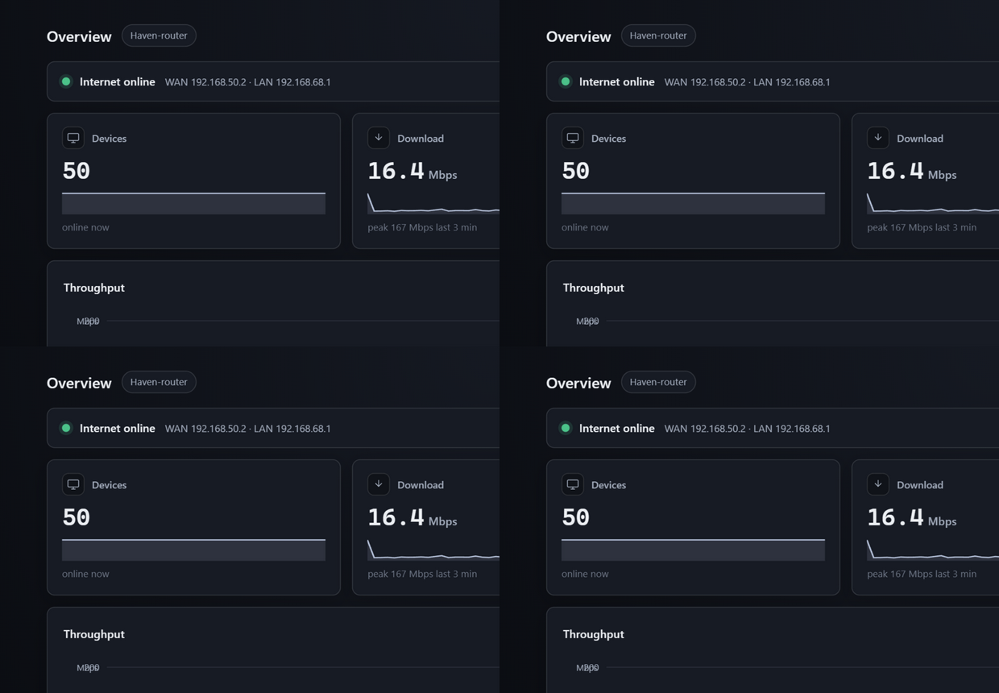

<div align="center">

# HavenWRT

**A calm, unified router firmware and web interface for OpenWrt x86-64.**

[](https://github.com/bfrye26/HavenWRT/releases/latest)
[](#license)
[](https://openwrt.org/)

[Download](https://github.com/bfrye26/HavenWRT/releases/latest) · [Install](#installation) · [Features](#features) · [Add-ons](#add-ons) · [Security](#security)

</div>



---

## What is HavenWRT?

HavenWRT is a complete router firmware **and** management interface built on OpenWrt 25.12.6 for x86-64 hardware. It replaces the scattered LuCI pages with one calm, coherent interface that answers the question you actually have — *"is my network okay right now?"* — and puts everything else one click away.

It is **not a LuCI theme**. It's a standalone, dependency-free JavaScript app that talks to OpenWrt's native `ubus` API, packaged as a full firmware image with a guided installer, a Docker app store, and a set of native add-on dashboards you can switch on or off.

**Why it feels different:**
- **One design system, six themes.** Every page shares the same calm, sentence-case components and semantic color tokens — including a proper light theme.
- **Quiet until something's wrong.** The dashboard stays out of your way when the network is healthy, and surfaces problems *with the action to fix them* when it isn't.
- **Honest numbers.** Real units, real axes, correct time windows — no misleading graphs.
- **Off by default.** Powerful add-ons ship disabled; you turn on only what you want.

---

## Features

### Network health at a glance
A redesigned dashboard: internet status strip, **Devices / Download / Upload** cards with sparklines, an honest throughput graph, a **"Needs attention"** panel, and compact CPU / memory bullets. Reboot and service restarts live in a menu, not loud buttons.

### Full network control
- **Security profiles** — Admin / Children / Guest / Smart-Devices presets with clear WAN-access control, curfews, and per-profile DNS.
- **Isolated networks** that still reach the internet (guest / IoT segments with NAT, kept separate from your main LAN).
- **Points of entry** — Ethernet port profiles and Wi-Fi password profiles, with rollback-safe apply.
- **VPN & failover** — WireGuard tunnel health, per-policy routing, and a kill-switch.
- **DNS record publishing (RFC 2136)** and **delegated port opening** — both opt-in, both off by default.
- **Real device identity** — vendors resolved from the full IEEE OUI registry (~40,000 prefixes), with private/randomized-MAC detection.

### One-click apps
A curated Docker app store with reviewed, digest-pinned templates — AdGuard Home, Pi-hole, Vaultwarden, Syncthing, Home Assistant, Uptime Kuma, and more — with native in-UI integrations for Pi-hole, AdGuard Home, and Uptime Kuma. LAN-only firewall by default; sensitive-data apps are gated.

### Signed, opt-in updates
Firmware artifacts are usign-signed. The upgrade UI verifies the signature **before** installing; a bad signature blocks the install. Nothing updates automatically.

---

## Add-ons

Native dashboards, each with its own **on/off toggle** in the Features control center. Turning one on enables its service and reveals its dashboard; turning it off stops the service and hides it. **All ship off.**

| Add-on | What it does |
|---|---|
| **SQM / Bufferbloat** | Smart queue management (cake / fq_codel) to keep latency low under load |
| **Bandwidth Monitor** | Per-device top talkers, totals, and protocol breakdown (nlbwmon) |
| **Multi-WAN / Failover** | Load-balance and fail over across WAN uplinks (mwan3) |
| **Ad Blocking** | Network-wide DNS ad / malware blocking (adblock) |
| **Tailscale VPN** | Zero-config mesh VPN to reach your network from anywhere |
| **Web Terminal** | Browser terminal with htop (ttyd), LAN-only |
| **Statistics** | CPU / memory / load / network graphs (collectd) |
| **NAS / File Sharing** | Share USB drives over Samba (block-mount) |

WireGuard lives in **VPN & Failover**; AdGuard Home and Pi-hole are one-click apps.

---

## Installation

HavenWRT ships as a **signed firmware image** and a **guided dual-boot installer ISO** (boots on both BIOS/CSM and UEFI). Grab them from the [latest release](https://github.com/bfrye26/HavenWRT/releases/latest).

**Requirements:** x86-64 device, ≥16 GiB disk, two wired NICs.

### Fresh install (recommended)
Write the installer ISO to a USB stick and boot the target:

```bash
dd if=MoCI-x86-64-Installer.iso of=/dev/sdX bs=4M conv=fsync
# or use Rufus / balenaEtcher
```

Follow the guided installer. The ISO is **fresh-install only** — it is never a sysupgrade payload.

### Direct image write
```bash
gunzip -c openwrt-x86-64-generic-ext4-combined-efi.img.gz | dd of=/dev/sdX bs=4M conv=fsync
```

### Upgrade an existing Haven router
Upload the image (`.img.gz`) and its `.sig` on **System → Firmware Upgrade**. Haven verifies the signature, runs `sysupgrade --test`, then flashes after you confirm. Network / Wi-Fi / firewall configuration is preserved.

> **Note:** full-image x86 sysupgrade does not preserve root-resident Docker app data. Back up app data first, or upgrade empty-app systems.

After install, open `http://<router-ip>/moci/` and sign in with your root credentials.

---

## Verifying downloads

Every artifact ships with a SHA-256 checksum (`SHA256SUMS`) and a detached usign signature (`.sig`). The public key is baked into the firmware at `/etc/moci/moci-image.pub` and committed as [`files/moci-image.pub`](files/moci-image.pub).

```bash
sha256sum -c SHA256SUMS
usign -V -p moci-image.pub -m openwrt-x86-64-generic-ext4-combined-efi.img.gz \
      -x openwrt-x86-64-generic-ext4-combined-efi.img.gz.sig
usign -V -p moci-image.pub -m MoCI-x86-64-Installer.iso -x MoCI-x86-64-Installer.iso.sig
```

---

## Security

- **firewall4 / nftables stays.** No automatic WAN publishing; no unrestricted LAN forwarding.
- **Opt-in by default:** UPnP (secure mode enforced), delegated ports, and DNS publishing are off until you enable them.
- **Add-ons are off by default;** the web terminal is LAN-only and clearly warned.
- **No Docker socket exposure;** sensitive-data apps require explicit approval.
- **Secrets are never exposed to the browser.** Authentication and authorization use OpenWrt's native ubus sessions + rpcd ACLs — the same model as LuCI, validated server-side.

---

## Building from source

The firmware is built from an OpenWrt 25.12.6 tree with the Haven package and a curated package set:

```bash
# frontend bundle
npm install
npm run build            # -> dist/moci

# full firmware image (in a prepared OpenWrt build environment)
bash firmware/scripts/build.sh

# guided installer ISO
bash firmware/installer/build-live-iso.sh <image.img.gz> <output-dir>
```

See [`firmware/scripts/build.sh`](firmware/scripts/build.sh) for the package set and [`scripts/build-ship-local.sh`](scripts/build-ship-local.sh) for the reproducible local build flow.

### Project layout

```
moci/                  Web UI (vanilla ES-module SPA)
  index.html           App shell + pages
  app.css              Unified design tokens + components (6 themes)
  js/core.js           ubus client, routing, shared helpers
  js/modules/          Feature modules (dashboard, network, add-ons, …)
firmware/              OpenWrt image build + installer ISO
integrations/          Docker app store + native app integrations
files/                 rpcd ACLs, services, defaults, signing pubkey
tests/                 Frontend + contract test suites
```

---

## Tested hardware

Validated end-to-end on a **P09B / J4125 mini-PC with 6× Intel I225-V** (all ports, Wi-Fi AP, WAN/DNS, firewall, add-ons, profiles, app store, signed updates), plus lab VMs. Other x86-64 devices with supported NICs should work; multi-port bring-up bridges all non-WAN ports into the LAN automatically.

---

## License

MIT. Built on [OpenWrt](https://openwrt.org/). HavenWRT is an independent project and is not affiliated with the OpenWrt project.